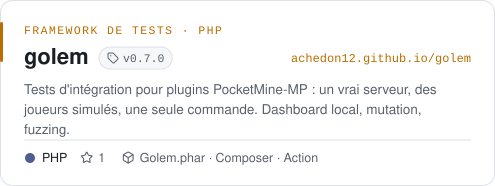
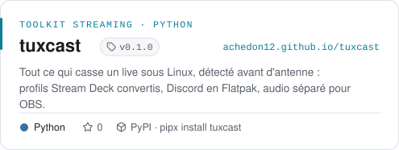
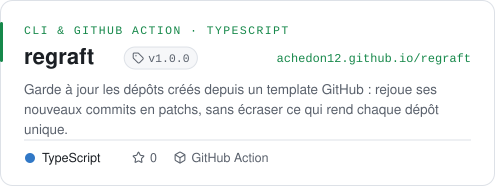
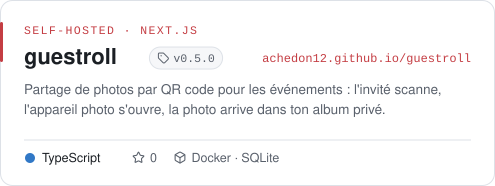
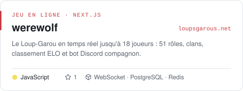
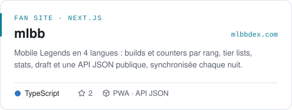
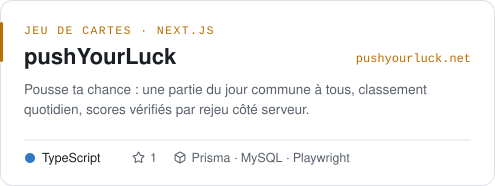
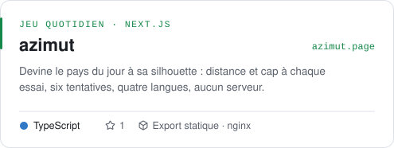
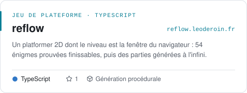
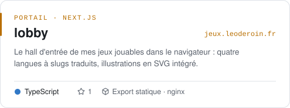

<a href="https://leoderoin.fr">
  <picture>
    <source media="(prefers-color-scheme: dark)" srcset="assets/header-dark.svg">
    
  </picture>
</a>

  
  
  
  
  
  

## En bref

Je construis des applications web de bout en bout : un back **Symfony** (ou Phalcon, Node), une interface **React / Next.js** ou **Vue**, une base **MySQL**, le tout livré avec **Docker**. J'aime les projets qui ont une raison d'exister, et les interfaces où il se passe quelque chose.

Deux ans d'alternance chez **Confluent Digital** à livrer des outils SaaS pour des PME, un **Master Ingénierie du web** à l'ESGI terminé en septembre 2026. Je cherche maintenant un **CDI de développeur fullstack**, depuis Besançon.

| Période | Poste | Où |
| :-- | :-- | :-- |
| 2024 → 2026 | Développeur fullstack, alternance · Next.js, Symfony, MySQL, Docker | Confluent Digital, Lyon |
| 2024 → 2026 | Master Ingénierie du web | ESGI |
| 2023 → 2024 | Développeur fullstack, alternance · React Native, Expo, PHP, Python | ELIPCE Solutions, Valence |
| 2021 → 2024 | BUT Informatique | Université Grenoble Alpes |

## Stack

<table>
  <tr>
    <td width="120"><b>FRONT</b></td>
    <td>
      <picture>
        <source media="(prefers-color-scheme: dark)" srcset="https://skillicons.dev/icons?i=ts,js,react,nextjs,vue,tailwind,threejs,html,css&theme=dark&perline=12">
        
      </picture>
    </td>
  </tr>
  <tr>
    <td><b>BACK</b></td>
    <td>
      <picture>
        <source media="(prefers-color-scheme: dark)" srcset="https://skillicons.dev/icons?i=php,symfony,nodejs,nestjs,express,python,go&theme=dark&perline=12">
        
      </picture>
    </td>
  </tr>
  <tr>
    <td><b>DONNÉES</b></td>
    <td>
      <picture>
        <source media="(prefers-color-scheme: dark)" srcset="https://skillicons.dev/icons?i=mysql,postgres,prisma,sqlite,redis,mongodb&theme=dark&perline=12">
        
      </picture>
    </td>
  </tr>
  <tr>
    <td><b>DEVOPS</b></td>
    <td>
      <picture>
        <source media="(prefers-color-scheme: dark)" srcset="https://skillicons.dev/icons?i=docker,linux,nginx,githubactions,git,bash&theme=dark&perline=12">
        
      </picture>
    </td>
  </tr>
  <tr>
    <td><b>QUALITÉ & OUTILS</b></td>
    <td>
      <picture>
        <source media="(prefers-color-scheme: dark)" srcset="https://skillicons.dev/icons?i=vitest,playwright,vite,figma,blender&theme=dark&perline=12">
        
      </picture>
    </td>
  </tr>
</table>

## Outils open source

  <a href="https://github.com/achedon12/golem"><picture><source media="(prefers-color-scheme: dark)" srcset="assets/project-golem-dark.svg"></picture></a>
  <a href="https://github.com/achedon12/tuxcast"><picture><source media="(prefers-color-scheme: dark)" srcset="assets/project-tuxcast-dark.svg"></picture></a>
  <a href="https://github.com/achedon12/regraft"><picture><source media="(prefers-color-scheme: dark)" srcset="assets/project-regraft-dark.svg"></picture></a>
  <a href="https://github.com/achedon12/guestroll"><picture><source media="(prefers-color-scheme: dark)" srcset="assets/project-guestroll-dark.svg"></picture></a>

## En ligne

  <a href="https://loupsgarous.net"><picture><source media="(prefers-color-scheme: dark)" srcset="assets/project-werewolf-dark.svg"></picture></a>
  <a href="https://mlbbdex.com"><picture><source media="(prefers-color-scheme: dark)" srcset="assets/project-mlbb-dark.svg"></picture></a>
  <a href="https://pushyourluck.net"><picture><source media="(prefers-color-scheme: dark)" srcset="assets/project-pushyourluck-dark.svg"></picture></a>
  <a href="https://azimut.page"><picture><source media="(prefers-color-scheme: dark)" srcset="assets/project-azimut-dark.svg"></picture></a>
  <a href="https://reflow.leoderoin.fr"><picture><source media="(prefers-color-scheme: dark)" srcset="assets/project-reflow-dark.svg"></picture></a>
  <a href="https://jeux.leoderoin.fr"><picture><source media="(prefers-color-scheme: dark)" srcset="assets/project-lobby-dark.svg"></picture></a>

Plus de 40 projets détaillés, avec captures et contexte, dans la [galerie du site](https://leoderoin.fr/projects).

## Plugins PocketMine-MP

J'ai commencé par Minecraft Bedrock : des plugins PocketMine-MP distribués en `.phar`, et une chaîne YouTube de tutos pour en écrire. [Golem](https://github.com/achedon12/golem) en est la suite logique : le framework de tests que j'aurais voulu avoir à l'époque.

<b>Voir les plugins</b> · API 3, 4 et 5

 

| Plugin | Ce qu'il fait | API |
| :-- | :-- | :-: |
| [Faction](https://github.com/achedon12/Faction) | Système de factions | 5 |
| [HangGlider](https://github.com/achedon12/HangGlider) | Deltaplane configurable pour planer | 5 |
| [LobbySystem](https://github.com/achedon12/LobbySystem) | Lobby de serveur | 5 |
| [DailyQuest](https://github.com/achedon12/DailyQuest) | Quêtes quotidiennes | 5 |
| [DamageIndicator](https://github.com/achedon12/DamageIndicator) | Affichage des dégâts infligés | 5 |
| [AcademyMC](https://github.com/achedon12/AcademyMC) | Core du serveur AcademyMC | 5 |
| [SimpleCustomTPA](https://github.com/achedon12/SimpleCustomTPA) | Téléportation entre joueurs personnalisable | 4 |
| [NickSystem](https://github.com/achedon12/NickSystem) | Changement de pseudo, `/nick` et `/unnick` | 4 |
| [MineralContest](https://github.com/achedon12/MineralContest) | Le mode de jeu Mineral Contest | 4 |
| [SimpleUHC](https://github.com/achedon12/SimpleUHC) | Mode de jeu UHC | 4 |
| [RandomOre](https://github.com/achedon12/RandomOre) | Minerais aléatoires configurables | 4 |
| [VoidStone](https://github.com/achedon12/VoidStone) | Récupère la pierre minée dans un item | 4 |
| [Hammer](https://github.com/achedon12/Hammer) | Marteau qui mine en 3×3×2 | 4 |
| [Atm](https://github.com/achedon12/Atm) | Distributeur compatible BedrockEconomy | 4 |
| [Lottery](https://github.com/achedon12/Lottery) | Loterie compatible BedrockEconomy | 4 |
| [KillReward](https://github.com/achedon12/KillReward) | Gagner de l'argent à chaque kill | 4 |
| [FoodEffect](https://github.com/achedon12/FoodEffect) | N'importe quel effet sur la nourriture | 4 |
| [StaffTools](https://github.com/achedon12/StaffTools) | Mode staff | 4 |
| [SpyMod](https://github.com/achedon12/SpyMod) | Voir les commandes exécutées par les joueurs | 4 |
| [WordBlocker](https://github.com/achedon12/WordBlocker) | Filtre de mots configurable | 4 |
| [CustomDisableCommands](https://github.com/achedon12/CustomDisableCommands) | Désactive les commandes de son choix | 4 |
| [CustomJoinLeaveMessage](https://github.com/achedon12/CustomJoinLeaveMessage) | Messages de connexion et de déconnexion | 4 |
| [GodMod](https://github.com/achedon12/GodMod) | Mode sans dégâts de chute | 4 |
| [CustomJoinmessage](https://github.com/achedon12/CustomJoinmessage) | Messages de bienvenue selon le joueur | 3 |
| [CustomBuyRankUI](https://github.com/achedon12/CustomBuyRankUI) | Achat de grades en jeu | 3 |
| [CustomKnockBack](https://github.com/achedon12/CustomKnockBack) | Knockback configurable | 3 |
| [CustomMinage](https://github.com/achedon12/CustomMinage) | Zones de minage configurables | 3 |

## Activité

  <picture><source media="(prefers-color-scheme: dark)" srcset="assets/stats-dark.svg"></picture>
  <picture><source media="(prefers-color-scheme: dark)" srcset="assets/languages-dark.svg"></picture>

<picture>
  <source media="(prefers-color-scheme: dark)" srcset="https://raw.githubusercontent.com/achedon12/achedon12/output/snake-dark.svg">
  
</picture>

Cartes régénérées chaque jour par <a href=".github/workflows/cards.yml">une GitHub Action</a> · <a href="https://leoderoin.fr">leoderoin.fr</a>

