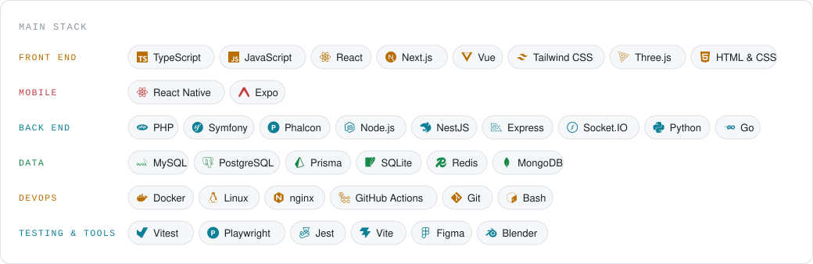
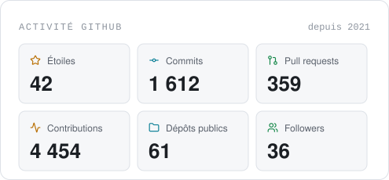
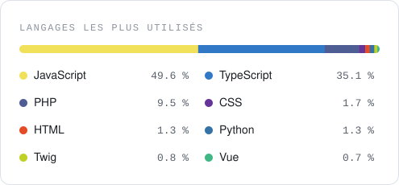

<a href="https://leoderoin.fr">
  <picture>
    <source media="(prefers-color-scheme: dark)" srcset="assets/header-dark.svg">
    
  </picture>
</a>

  
  
  
  
  
  

## About me

- 💻 **Full-stack developer** based in Besançon, France: a **Symfony** or Node back end, a **React / Next.js** or Vue front end, shipped with **Docker**
- 🎓 **Master's degree in Web Engineering** from ESGI, completed in September 2026
- 🏢 **Two years as a work-study developer** at Confluent Digital, shipping SaaS tools for small businesses
- 🎯 I like projects with a reason to exist, and interfaces where something happens
- 📫 **Open to a full-time role**: [pro@leoderoin.fr](mailto:pro@leoderoin.fr)

## Stack

<picture>
  <source media="(prefers-color-scheme: dark)" srcset="assets/stack-dark.svg">
  
</picture>

## Activity

  <picture><source media="(prefers-color-scheme: dark)" srcset="assets/stats-dark.svg"></picture>
  <picture><source media="(prefers-color-scheme: dark)" srcset="assets/languages-dark.svg"></picture>

<picture>
  <source media="(prefers-color-scheme: dark)" srcset="https://raw.githubusercontent.com/achedon12/achedon12/output/snake-dark.svg">
  
</picture>

Projects, screenshots and stories on <a href="https://leoderoin.fr">leoderoin.fr</a>

